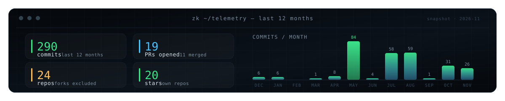

  

  
  
  

## Hi, I'm zk

**AI application engineer · product-minded builder.**

I turn fuzzy requirements into software people can actually use every day — agent runtimes, RAG pipelines, long-term memory, and the product surfaces that wrap them. My favourite work sits in the seam between *what a model can do* and *what a team can ship*.

> 把模糊需求拆成可运行、可交付的产品：Agent 运行时、RAG 知识库、模型接入，以及围绕它们的真实产品界面。判断标准是它能否稳定进入日常工作流，而不是能否做出一场演示。

| **Build** | **Agents** | **Craft** | **Ship** |
| :---: | :---: | :---: | :---: |
| TypeScript · Vue 3 · React · Python · Rust | Agent runtimes · MCP · RAG · memory | Interaction design · 3D / WebGL · visual systems | Docker Compose · Nginx · CI · release automation |

## 01 / Now

- **OpenViking** — pushing time-range filters, bounded query-cache TTL and compile-pipeline media evidence upstream ([PR #7324](https://github.com/volcengine/OpenViking/pull/7324), [#6905](https://github.com/volcengine/OpenViking/pull/6905), [#6942](https://github.com/volcengine/OpenViking/pull/6942)).
- **A design workbench** — a Vue + Claude Chat module: SSE streaming, multi-model adapters, prompt validation and marketing copy workflows.
- **A 3D career-chat site** — React 19 + Three.js + an agent runtime, streaming answers on top of a public, low-sensitivity career corpus.

## 02 / Selected work

### Local-first document editing — [`vue-onlyoffice-local`](https://github.com/zuoanCo/vue-onlyoffice-local) · [live demo](https://onlyoffice.zkhi.top)
DOCX / XLSX / PPTX open as Blob URLs and edited entirely in the browser: no uploads, no document server. One zero-dependency core plus adapters for Vue 2/3, React, Angular and vanilla JS. 9 stars

### HalluciGuard — [`halluciguard`](https://github.com/zuoanCo/halluciguard) · [live demo](https://halluciguard.zkhi.top)
A reliability layer between the model and the user. Claim-level verification, grounding checks, consistency analysis and citation verification turn *"I think this answer is good"* into a score you can reason about. 1 star

### zodstructor — [`zodstructor`](https://github.com/zuoanCo/zodstructor) · [live demo](https://zodstructor.zkhi.top)
Structured output for TypeScript LLM apps: define the contract once with Zod, get provider-native structured output, tool calling, validation-repair retries, network retries and streaming. 1 star

### guard-arch — [`guard-arch`](https://github.com/zuoanCo/guard-arch)
A modular AI agent runtime that unifies Agent, Skill, Tool, Memory, Context, Permission, Sandbox and Model behind one abstraction — the infrastructure for agents that are extensible, controllable and sustainable. 1 star

### vue3-super-tree — [`vue3-super-tree`](https://github.com/zuoanCo/vue3-super-tree)
A tree component for Vue 3 that folds a wide range of everyday tree requirements into one package. 3 stars

### Seedance Story Director — [`Seedance-Story-Director-Plugin`](https://github.com/zuoanCo/Seedance-Story-Director-Plugin)
An enterprise-native OpenClaw plugin: a story text becomes an executable shot plan, Seedance 2.0 renders the clips, and the pieces are assembled locally into a deliverable short video. 2 stars

## 03 / Upstream contributions

| Project | What I worked on |
| :--- | :--- |
| [volcengine/OpenViking](https://github.com/volcengine/OpenViking) | Deterministic time-range filters for session/directory listing · bounded query-cache TTL on shared Redis · per-backend tool-result media support · self-space fallback when memory ranges resolve to no writable target |
| [openclaw/openclaw](https://github.com/openclaw/openclaw) | Silent cron replies · reasoning-prefixed `NO_REPLY` suppression · subagent session reactivation · browser SSRF policy in the sandbox · han normalization for lexical sub-queries |
| [opendatalab/MinerU](https://github.com/opendatalab/MinerU) | Trim the glibc heap after document analysis to prevent OOM |
| [penpot/penpot](https://github.com/penpot/penpot) | Plugin API: context-menu contributions, non-modal panels/dialogs and anchor-based placement helpers |
| [vueuse/vueuse](https://github.com/vueuse/vueuse) · [shlinkio/shlink](https://github.com/shlinkio/shlink) · [Trae-AI/TRAE](https://github.com/Trae-AI/TRAE) | Issue reports and fixes around scrolling, access limits and model support |

## 04 / Stack

**Frontend** — TypeScript · JavaScript · Vue 3 · React 19 · Vite · Three.js · Tailwind
**AI & agents** — Agent runtimes · MCP · RAG · long-term memory · OpenAI-compatible Responses API · DeepSeek Harness (ACP)
**Backend & infra** — Python · FastAPI · Flask · Flutter · Docker Compose · Nginx · Linux · MySQL
**Tooling** — PowerShell · Rust · GitHub Actions · VS Code

## 05 / Telemetry

  

---

  Built by zk — design, engineering, automation. <a href="https://github.com/zuoanCo?tab=repositories">More repos →</a>

