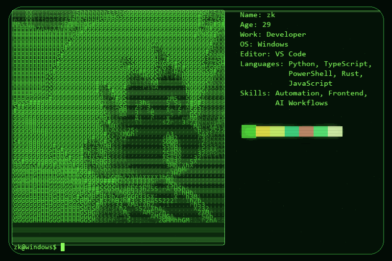

  

<h1 align="center">zk</h1>

  <strong>Web Engineer · Visual Development · Building toward Software Architecture</strong>

  
  
  
  
  

## About

I design and build clear, fast, and dependable web experiences. My work sits at the intersection of frontend engineering, visual craft, and practical automation.

| Focus | What I bring |
| --- | --- |
| **Interfaces** | Thoughtful UI, responsive implementation, and strong visual hierarchy. |
| **Automation** | Repeatable developer workflows with Python and PowerShell. |
| **Architecture** | Systems thinking: maintainable boundaries, reliable tools, and room to grow. |

## Current toolkit

`TypeScript` · `JavaScript` · `Python` · `PowerShell` · `Rust` · `Windows` · `VS Code`

---

Crafted with care by zk.

